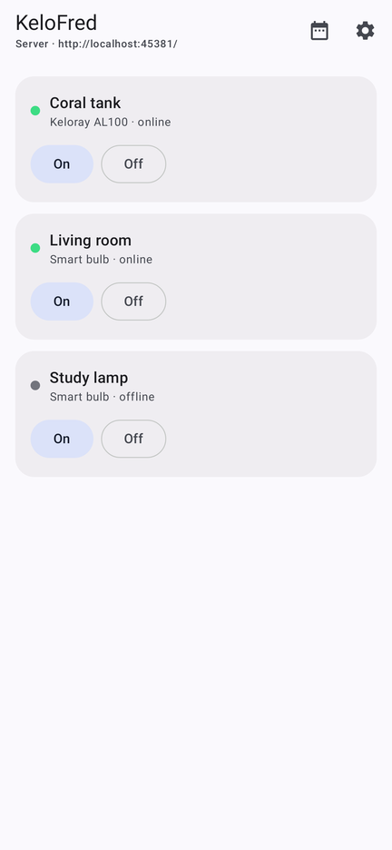
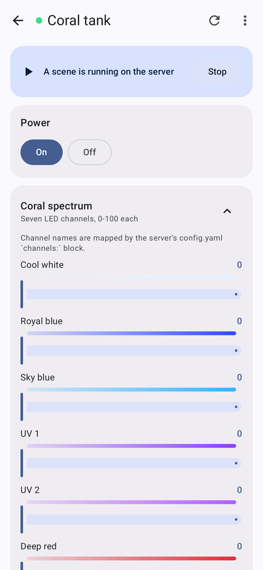
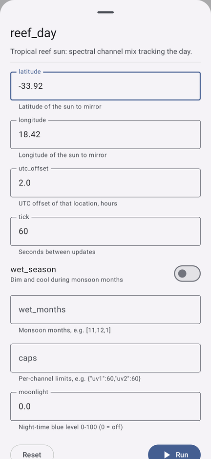
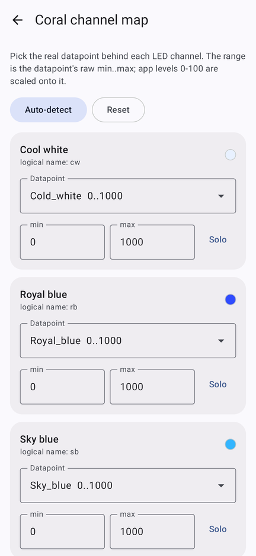
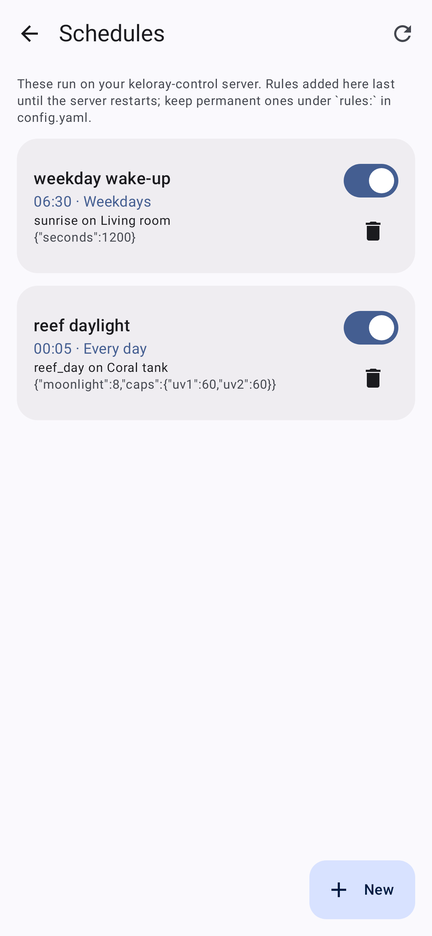
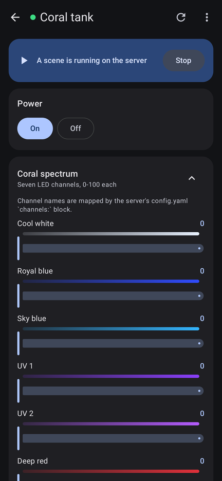

# KeloFred for Android

A native Android app for [`keloray-control`](../keloray-control/). It controls
Keloray / Gizwits smart lights from your phone: power, brightness, colour, the
seven coral LED channels, all eleven scenes (including `tropics`, `reef_day`
and `reef_storm`), and schedules.

<p>
  
  
  
  
  
  
</p>

## Two ways to connect

| | **Cloud (direct)** | **My server** |
|---|---|---|
| What the phone talks to | The Gizwits cloud, like the official app | Your `keloray serve` (e.g. on a Raspberry Pi) |
| Where scenes run | On the phone, in a foreground service | On the server |
| Schedules | Phone alarms (exact, survive reboots) | The server's scheduler |
| Needs anything else running? | No | Yes, the server |
| Best for | Quick control, short scenes, no extra hardware | All-day `reef_day` / `tropics` that must never stop |

You can switch at any time in Settings.

## Install

The app is not on Google Play. Every push to `main` builds a signed APK in
GitHub Actions:

1. On GitHub open **Actions → Android**, pick the latest green run and download
   the **kelofred-apk** artifact (a zip containing the APK).
2. Copy the APK to your phone and open it. Android asks you to allow installs
   from that app (Files, Chrome, etc.) the first time.

Pushing a tag such as `android-v0.1.0` also attaches the APK to a GitHub
Release, which is easier to download from the phone itself.

Every build is signed with the same committed sideload key, so a new APK
installs over the old one and keeps your settings.

Or, with the phone plugged in and USB debugging on:

```bash
cd keloray-android
./gradlew installRelease
```

## First run (cloud mode)

1. Pick your region (China, Americas or Europe).
2. Tap **Find**. The app tries the App-Ids built into the Keloray app (the same
   ones `python -m keloray probe` tries) in every region and fills in the one that
   answers.
3. Enter the username and password you use in the Keloray app and tap
   **Sign in**.

The password is encrypted with a key held in the Android Keystore. It is only
used to sign in again when the Gizwits session expires. Credentials are
excluded from Android backups.

## Coral fixtures (AL-series)

The seven channel sliders, `reef_day` and `reef_storm` use the logical channel
names `cw rb sb uv1 uv2 dr g`. In cloud mode, map them to your fixture's real
datapoints once:

1. Open the fixture, then **⋮ → Coral channel map**.
2. Tap **Auto-detect**. It reads the product's datapoint schema and guesses each
   channel from names like `Royal_blue` or `UV1`, including the raw range
   (e.g. 0..1000).
3. Tap **Solo** on each channel to light only that LED and check the guess.
   Fix any wrong ones from the dropdown.
4. **Save channel map**.

**⋮ → Datapoints** shows the full schema and current values, like
`python -m keloray discover`. In server mode the server's `channels:` block in
`config.yaml` does the mapping instead.

## Scenes

Tap a scene to see its options, prefilled with the same defaults as the Python
package. If you set a **home location** in Settings, the sun trackers
(`tropics`, `reef_day`) prefill its latitude, longitude and UTC offset.

In cloud mode, running scenes show an ongoing notification with **Stop all**.
Continuous scenes (`tropics`, `reef_day`, `color_loop` and friends) resume by
themselves if Android kills the app or the phone reboots. For long scenes with
the screen off, allow unrestricted battery use for KeloFred (Settings has a
shortcut). A phone still isn't an always-on controller, so for all-day reef
lighting use server mode.

## Server mode

On the machine that runs keloray-control:

```bash
python -m keloray serve --host 0.0.0.0
```

Then enter its address in the app, e.g. `http://192.168.1.50:8000`. The API has
no authentication, so only expose it on a network you trust.

Schedules you add from the app live in the server's memory until it restarts.
Keep permanent ones under `rules:` in `config.yaml`.

## Build from source

Needs JDK 17+ and the Android SDK (platform 36).

```bash
cd keloray-android
./gradlew testDebugUnitTest    # unit + UI tests (JVM, no emulator needed)
./gradlew assembleRelease      # app/build/outputs/apk/release/app-release.apk
```

The UI tests render the real screens with Robolectric against a fake
keloray-control server, check what the buttons send, and save screenshots to
`app/build/screenshots/`.

### Staying in step with keloray-control

The solar model, reef spectrum, channel mapping and schema normalization are
ports of the Python code. `GoldenTest` replays cases recorded from the Python
package and checks that the Kotlin output is identical, number for number. After
changing those Python modules, regenerate the cases and rerun the tests:

```bash
python keloray-android/tools/gen_golden.py
cd keloray-android && ./gradlew testDebugUnitTest
```

## Layout

```
app/src/main/java/com/kelofred/keloray/
  core/      pure Kotlin ports: Solar, Reef, Channels, SchemaNormalizer, Scenes
  data/      GizwitsClient, ServerClient, Backend (direct / server), stores
  engine/    SceneRunner, SceneService (foreground), schedule alarms
  ui/        Compose screens: setup, devices, device, datapoints,
             channel map, schedules, settings
tools/gen_golden.py   records Python reference cases for GoldenTest
```

## Notes

- This is an unofficial client. It talks to the same Gizwits OpenAPI the
  Keloray app uses, for your own devices on your own account.
- `app/signing/sideload.keystore` is deliberately public. It only exists so
  every build has the same signature for sideloading. Never use it for a Play
  Store release.
- Lightning in `thunderstorm` / `reef_storm` is approximate: cloud writes are
  rate-limited (Settings → minimum gap, default 250 ms).
